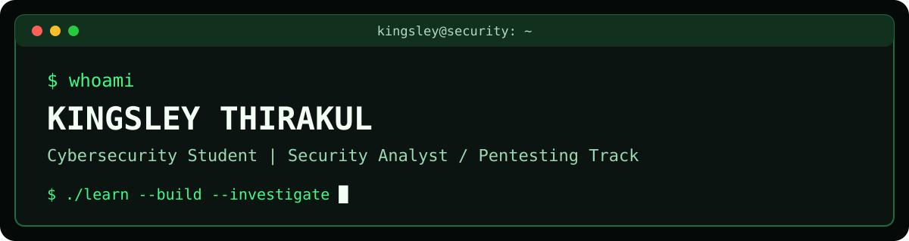

## Kingsley Thirakul
**Cybersecurity Student | Aspiring Security Analyst & Penetration Tester**

```bash
kingsley@security:~$ whoami
Kingsley Thirakul

kingsley@security:~$ cat skills.txt
> Linux | Wireshark | Network Security
> Log Analysis | Git | GitHub

kingsley@security:~$ ls projects/
Ubuntu-Security-Lab

kingsley@security:~$ echo $STATUS
[ ACTIVE ] Learning and Building
```

### Featured Project
[SSH Hardening Lab](https://github.com/KingsleyT1/ssh-hardening-lab)

Securing Linux SSH access through key based authentication, disabling password logins, and preventing root SSH access.
